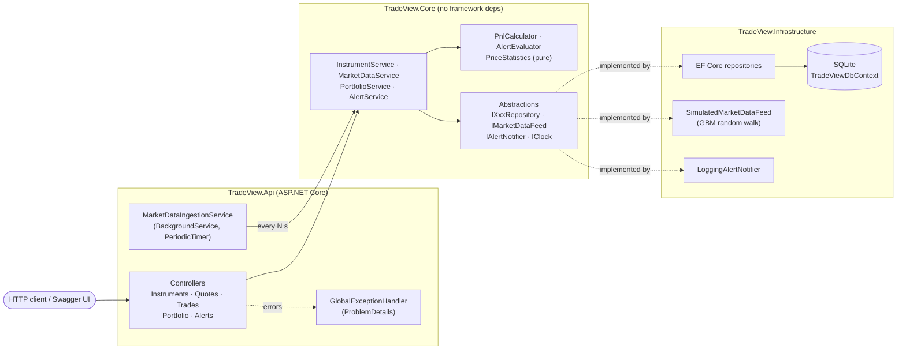

# TradeView — Market Data REST API

TradeView is an ASP.NET Core (.NET 8) REST API for real-time market data tracking. It:

- **Ingests live prices** for a universe of instruments (equities, crypto, FX, commodities) on a
  background loop and stores every tick with **Entity Framework Core** (SQLite by default).
- Serves **latest quotes, tick history and OHLC/VWAP summaries** over arbitrary time windows.
- Records **buy/sell trades** and calculates **realized and unrealized P&L** per position and for the
  whole portfolio (average-cost method, fees included), marked to the latest quote.
- Lets you configure **price alerts** (`PriceAbove`, `PriceBelow`, `PercentMove`), one-shot or
  repeating with a cooldown, which are evaluated against every new tick and kept as a trigger history.

All I/O is `async` end to end with `CancellationToken` propagation, and the service layer is covered by
an **xUnit** test suite.

The default price source is a **geometric random-walk simulator**, so the API runs fully offline
with no API keys. A real vendor feed can be plugged in by implementing `IMarketDataFeed`.

## Architecture



Ingestion cycle (every `MarketData:PollIntervalSeconds`):

```
Feed.GetQuotes(active instruments, last persisted prices)
   -> persist PriceTicks
   -> AlertService.Evaluate(new ticks)   -> AlertTriggers persisted + IAlertNotifier
   -> (every 10 min) prune ticks older than TickRetentionHours
```

### Project layout

```
TradeView.sln
src/
  TradeView.Core/            Domain entities, service layer, pure calculators, abstractions
  TradeView.Infrastructure/  EF Core DbContext + configurations, repositories, simulated feed, seeding
  TradeView.Api/             Controllers, request/response contracts, background ingestion, Program.cs
tests/
  TradeView.Tests/           xUnit: Unit/ (pure logic) and Integration/ (services on in-memory SQLite)
```

### Key design decisions

| Concern | Decision |
|---|---|
| P&L method | Average cost, long-only. Buy fees are capitalised into cost; sell fees reduce realized P&L. Trades are replayed in execution order, so a back-dated sell that would ever make the position negative is rejected (as is deleting a buy that covers a later sell). |
| Market orders | `POST /api/trades` without `price` fills at the latest quote. |
| Alerts | `PercentMove` measures from the reference price captured at creation (re-based when an alert is re-activated). One-shot alerts deactivate after firing; repeating alerts honour `cooldownSeconds`. Only the newest tick per instrument in a batch is evaluated. |
| Timestamps | Stored and returned in UTC (value converter tags them `DateTimeKind.Utc`). |
| Decimal math | `decimal` everywhere. Aggregates (OHLC, VWAP) are computed in memory because SQLite cannot aggregate decimals server-side. |
| Schema | `EnsureCreated()` on startup — no migrations needed to try it out. |
| Errors | RFC 7807 ProblemDetails: 400 validation, 404 not found, 409 conflict. |

## Running it

**Prerequisites:** [.NET 8 SDK](https://dotnet.microsoft.com/download). No external services, no API keys.

```bash
dotnet restore
dotnet run --project src/TradeView.Api
```

The API listens on `http://localhost:5080`. Swagger UI is at `http://localhost:5080/swagger`
(Development environment). On first start, a SQLite file `tradeview.db` is created next to the API
and eight instruments are seeded (AAPL, MSFT, NVDA, SPY, BTC-USD, ETH-USD, EUR-USD, XAU-USD). Prices
start streaming in immediately.

### Configuration

Everything lives in `src/TradeView.Api/appsettings.json` and can be overridden with environment
variables (see `.env.example`; `__` maps to `:`):

| Setting | Default | Meaning |
|---|---|---|
| `ConnectionStrings__TradeView` | `Data Source=tradeview.db` | EF Core SQLite connection string |
| `MarketData__PollIntervalSeconds` | `2` | Ingestion interval |
| `MarketData__VolatilityPercent` | `0.5` | Per-tick σ of the simulated log return |
| `MarketData__DriftPercent` | `0` | Per-tick drift of the simulated log return |
| `MarketData__RandomSeed` | *(unset)* | Fixed seed for reproducible prices |
| `MarketData__SeedInstruments` | `true` | Seed the default instrument universe |
| `MarketData__TickRetentionHours` | `24` | Prune older ticks (0 = keep forever) |
| `MarketData__IngestionEnabled` | `true` | Turn the background feed off |

```bash
cp .env.example .env
set -a && source .env && set +a
dotnet run --project src/TradeView.Api
```

### Endpoints

| Method | Route | Purpose |
|---|---|---|
| GET | `/api/instruments?activeOnly=` | List instruments |
| GET | `/api/instruments/{symbol}` | One instrument |
| POST | `/api/instruments` | Track a new instrument |
| PATCH | `/api/instruments/{symbol}` | Rename / pause / resume ingestion |
| GET | `/api/quotes` | Latest quote for every instrument |
| GET | `/api/quotes/{symbol}` | Latest quote |
| GET | `/api/quotes/{symbol}/history?from=&to=&limit=` | Tick history (default: last hour) |
| GET | `/api/quotes/{symbol}/summary?from=&to=` | OHLC, change %, volume, VWAP |
| GET | `/api/trades?symbol=&from=&to=` | List trades |
| GET | `/api/trades/{id}` | One trade |
| POST | `/api/trades` | Record a buy/sell |
| DELETE | `/api/trades/{id}` | Delete a trade |
| GET | `/api/portfolio/pnl?includeClosed=` | Portfolio realized/unrealized P&L |
| GET | `/api/portfolio/positions/{symbol}` | Position P&L for one instrument |
| GET | `/api/alerts?symbol=&activeOnly=` | List alerts |
| GET | `/api/alerts/{id}` | One alert |
| POST | `/api/alerts` | Create an alert |
| PATCH | `/api/alerts/{id}` | Change threshold / cooldown / repeat, (re)activate |
| DELETE | `/api/alerts/{id}` | Delete an alert |
| GET | `/api/alerts/triggers?symbol=&since=&limit=` | Fired-alert history |
| GET | `/api/alerts/{id}/triggers` | History for one alert |
| GET | `/health` | Health check (includes database) |

### Example session

```bash
# Latest prices
curl -s localhost:5080/api/quotes/AAPL

# Buy 10 AAPL at market, then sell 4 at a fixed price
curl -s -X POST localhost:5080/api/trades -H 'Content-Type: application/json' \
  -d '{"symbol":"AAPL","side":"Buy","quantity":10,"fees":1}'
curl -s -X POST localhost:5080/api/trades -H 'Content-Type: application/json' \
  -d '{"symbol":"AAPL","side":"Sell","quantity":4,"price":195.50}'

# P&L
curl -s localhost:5080/api/portfolio/pnl

# Fire when BTC moves 0.5% either way, at most once a minute
curl -s -X POST localhost:5080/api/alerts -H 'Content-Type: application/json' \
  -d '{"symbol":"BTC-USD","condition":"PercentMove","threshold":0.5,"isRepeating":true,"cooldownSeconds":60}'

# What fired?
curl -s 'localhost:5080/api/alerts/triggers?limit=20'
```

## Testing

```bash
dotnet test
```

The xUnit suite in `tests/TradeView.Tests` contains:

- **Unit** — `PnlCalculatorTests` (average cost, fees, partial/full closes, ordering, oversell),
  `AlertEvaluatorTests` (every condition, boundaries, one-shot vs repeating, cooldown),
  `PriceStatisticsTests` (OHLC/VWAP), `SimulatedMarketDataFeedTests` (seed determinism, resume,
  rounding), `GlobalExceptionHandlerTests` (status mapping).
- **Integration** — `PortfolioServiceTests`, `AlertServiceTests`, `MarketDataServiceTests` run the real
  services and EF Core repositories against an in-memory **SQLite** database, so LINQ is translated
  exactly as in production. A `FixedClock` makes time-dependent behaviour deterministic.

Coverage:

```bash
dotnet test --collect:"XPlat Code Coverage"
```

## Extending

- **Real market data:** implement `IMarketDataFeed` (e.g. a Polygon/Alpaca adapter) and register it in
  `TradeView.Infrastructure/DependencyInjection.cs` in place of `SimulatedMarketDataFeed`.
- **Alert delivery:** implement `IAlertNotifier` (webhook, email, SignalR) and swap out
  `LoggingAlertNotifier`.
- **Another database:** replace `UseSqlite` with `UseNpgsql`/`UseSqlServer`; entity configurations
  already declare decimal precision and indexes.
